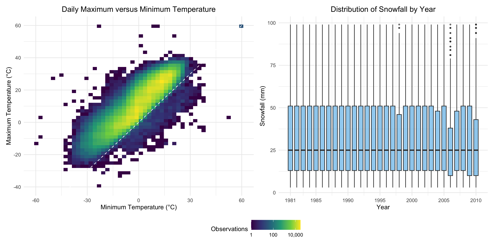

p8105_hw3_sw4257
================
Shwai Wang
2026-10-16

``` r
library(tidyverse)
library(p8105.datasets)
library(patchwork)
```

# Problem 1

## Data cleaning and description

``` r
data("ny_noaa")

ny_noaa_df = ny_noaa |>
  mutate(year = lubridate::year(date),
         month = lubridate::month(date),
         day = lubridate::day(date),
         tmax = as.numeric(tmax) / 10,
         tmin = as.numeric(tmin) / 10,
         prcp = as.numeric(prcp) / 10)
```

The cleaned NY NOAA dataset contains 2,595,176 observations from 747
weather stations and 10 variables. The data include station identifiers,
observation dates, precipitation, snowfall, snow depth, maximum
temperature, and minimum temperature. Separate variables for year,
month, and day were created from the date variable. Maximum and minimum
temperatures were converted to degrees Celsius, and precipitation was
converted to millimeters.

``` r
missing_summary = ny_noaa_df |>
  summarize(across(
    prcp:tmin, ~ sum(is.na(.)))) |>
  pivot_longer(everything(),
               names_to = "variable",
               values_to = "number_of_missing") |>
  mutate(percent_missing =
           round(number_of_missing / nrow(ny_noaa_df) * 100, 2))

missing_summary |>
  knitr::kable(col.names = c("Variable",
                             "Number Missing",
                             "Percent Missing (%)"))
```

| Variable | Number Missing | Percent Missing (%) |
|:---------|---------------:|--------------------:|
| prcp     |         145838 |                5.62 |
| snow     |         381221 |               14.69 |
| snwd     |         591786 |               22.80 |
| tmax     |        1134358 |               43.71 |
| tmin     |        1134420 |               43.71 |

Missing data are an important feature of this dataset. Missingness is
particularly substantial for maximum and minimum temperature, while
precipitation has comparatively fewer missing observations. This is
expected because individual weather stations do not necessarily report
every weather measurement.

## Common snowfall values

``` r
common_snowfall =
  ny_noaa_df |>
  drop_na(snow) |>
  count(snow, sort = TRUE)

common_snowfall |>
  slice_head(n = 10) |>
  knitr::kable(col.names = c("Snowfall (mm)", 
                             "Number of Observations"))
```

| Snowfall (mm) | Number of Observations |
|--------------:|-----------------------:|
|             0 |                2008508 |
|            25 |                  31022 |
|            13 |                  23095 |
|            51 |                  18274 |
|            76 |                  10173 |
|             8 |                   9962 |
|             5 |                   9748 |
|            38 |                   9197 |
|             3 |                   8790 |
|           102 |                   6552 |

The most commonly observed snowfall value was 0 mm, followed by values
including 25, 13, 51, and 76 mm. Zero is the most common value because
snowfall does not occur on most days. Several other common values
correspond approximately to measurements in half-inch or one-inch
increments after conversion to millimeters.

## January and July temperatures comparison

``` r
monthly_temperature = ny_noaa_df |>
  filter(month %in% c(1, 7)) |>
  group_by(id, year, month) |>
  summarize(mean_tmax = mean(tmax, na.rm = TRUE),
            .groups = "drop") |>  
  filter(is.finite(mean_tmax)) |>
  mutate(month = factor(month,
                        levels = c(1, 7),
                        labels = c("January", "July")))

yearly_average = monthly_temperature |>
  group_by(year, month) |>
  summarize(overall_mean = mean(mean_tmax),
            .groups = "drop")

monthly_temperature |> 
  ggplot(aes(x = year, y = mean_tmax, group = id)) +
  geom_line(alpha = 0.2, color = "grey70", linewidth = 0.3) +
  geom_line(data = yearly_average, 
            aes(x = year, y = overall_mean, group = 1),
            inherit.aes = FALSE,
            color = "navy",
            linewidth = 1) +
  facet_wrap(~month, nrow = 1) +
  scale_x_continuous(breaks = seq(1980, 2010, by = 10)) +
  labs(title = "Average Maximum Temperature by Station",
       subtitle = "Gray lines represent individual stations \nNavy lines represent yearly averages",
       x = "Year",
       y = "Average Maximum Temperature (°C)") +
  theme_minimal() + 
  theme(plot.title = element_text(hjust = 0.5),
        plot.subtitle = element_text(hjust = 0.5),
        panel.spacing = grid::unit(1.5, "lines"))
```


Average maximum temperatures were substantially lower and more variable
across stations in January than in July. Stations generally followed
similar year-to-year patterns, indicating that unusually warm or cold
years affected many stations across the state. A few potentially
outlying station-year averages are visible, including a particularly low
January value around 1982 and a low July value around 1988. These
extreme values may reflect local weather conditions or incomplete
monthly records rather than data errors.

## Temperature and Snowfall Distributions

``` r
temperature_plot = ny_noaa_df |>
  drop_na(tmin, tmax) |>
  ggplot(aes(x = tmin, y = tmax)) +
  geom_bin_2d(bins = 50) +
  geom_abline(slope = 1, intercept = 0, linetype = "dashed", color = "white") +
  scale_fill_viridis_c(trans = "log10", labels = scales::label_comma()) +
  labs(title = "Daily Maximum versus Minimum Temperature",
       x = "Minimum Temperature (°C)",
       y = "Maximum Temperature (°C)",
       fill = "Observations") +
  theme_minimal() +
  theme(plot.title = element_text(hjust = 0.5))

snowfall_plot = ny_noaa_df |>
  filter(snow > 0, snow < 100) |>
  ggplot(aes(x = year, y = snow, group = year)) +
  geom_boxplot(fill = "#56B4E9", 
               alpha = 0.6,
               width = 0.7, 
               outlier.alpha = 0.2, 
               outlier.size = 0.8) +
  scale_x_continuous(breaks = c(1981, 1985, 1990, 1995, 2000, 2005, 2010)) +
  scale_y_continuous(breaks = seq(0, 100, by = 25)) +
  labs(title = "Distribution of Snowfall by Year", 
       x = "Year",
       y = "Snowfall (mm)") +
  theme_minimal() +
  theme(axis.text.x = element_text(hjust = 0.5),
        plot.title = element_text(hjust = 0.5))


combined_plot = (temperature_plot + 
                   snowfall_plot + 
                   plot_layout(widths = c(1.1, 1), guides = "collect")) &
  theme(legend.position = "bottom")

combined_plot
```



Maximum and minimum temperatures showed a strong positive relationship
on the left. Each observation represents the minimum and maximum
temperatures recorded at one weather station on one day. Because the
dataset contains millions of daily observations, two-dimensional bins
were used instead of individual points. The color of each bin shows the
number of observations within that temperature range. The dashed line
represents values at which the maximum and minimum temperatures are
equal. Most observations were above this line, as expected because the
daily maximum temperature should generally be higher than the daily
minimum temperature. The small number of observations below the line may
indicate measurement or recording errors, while values far from the main
concentration may represent extreme or unusual observations.

For snowfall values greater than 0 mm and less than 100 mm, the yearly
distributions shown on the right were generally similar. Most years had
a median snowfall measurement of approximately 25 mm, although several
years contained relatively large snowfall observations near 100 mm.
